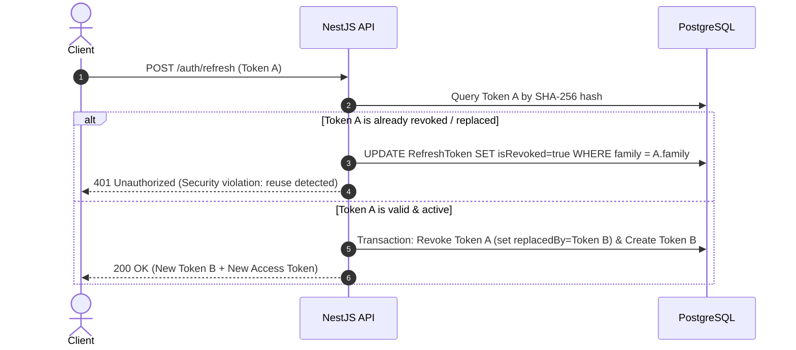
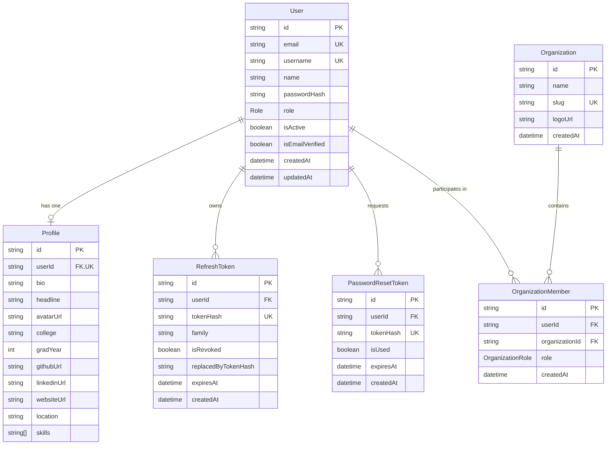

# NUMU — Phase 2: Authentication & User Management Specification

## 1. Executive Summary

Phase 2 implements a production-grade, cryptographically hardened **Authentication and User Management** foundation for the NUMU platform. 

The implementation balances enterprise security standards with seamless developer and user experience:
- **Argon2id** password hashing with constant-time dummy verification against account enumeration.
- **Dual-Token Architecture**: Short-lived JWT access tokens paired with rotating high-entropy refresh tokens.
- **Refresh Token Family Reuse Detection**: Automatic breach invalidation across entire token lineages.
- **Single-Use Password Recovery Tokens**: Cryptographic tokens that invalidate all active sessions upon password reset.
- **Role-Based Access Control (RBAC)**: Fine-grained access control covering `STUDENT`, `TRAINER`, `COLLEGE_ADMIN`, and `PLATFORM_ADMIN`.
- **Public vs. Private Profile Architecture**: Mass-assignment protection on updates and sanitization of private fields on public queries.
- **Multi-Tenant Organization Membership Foundation**: Initial tenant isolation foundation for college-specific cohorts.
- **Next.js App Router Integration**: Full cookie credential lifecycle (`HttpOnly`, `SameSite=Lax`) wired to real login and registration interfaces.

---

## 2. Architecture & Design Decisions

### 2.1. Dual-Token Strategy & Cookie Transport
- **Access Tokens**: Short-lived JWTs (15 minutes expiration). Signed with HMAC-SHA256 (`HS256`) and embedded with a unique JWT ID (`jti`) for auditing.
- **Refresh Tokens**: Long-lived (7 days default), generated with 256 bits of cryptographic entropy (`crypto.randomBytes(32).toString('hex')`).
- **Transport**:
  - Primary: Secure, `HttpOnly`, `SameSite=Lax`, environment-aware `Secure` cookies (`numu_access_token` and `numu_refresh_token`).
  - Fallback: `Authorization: Bearer <token>` header parsing for non-browser clients (CLI, mobile, automated tests, Swagger).
- **Trade-off Analysis**: Relying on `HttpOnly` cookies eliminates client-side XSS token theft vectors. `SameSite=Lax` combined with standard REST POST/PATCH origin semantics ensures robust CSRF protection without adding server-side CSRF token synchronization complexity.

### 2.2. Password Hashing & OWASP Compliance
- **Algorithm**: Argon2id via `@node-rs/argon2`.
- **Work Factors**:
  - Memory: `19456 KiB` (19 MiB)
  - Iterations: `2`
  - Parallelism: `1`
- **Native SIMD Acceleration**: Uses precompiled Rust N-API binaries, ensuring high throughput and native platform compatibility across Windows, macOS, and Linux without fragile C++ `node-gyp` builds.
- **Constant-Time Timing Attack Mitigation**: If login fails due to an unrecognized email or username, the system verifies a dummy hash against the submitted password. This equalizes CPU response times, mitigating user enumeration via response-timing discrepancies.

### 2.3. Refresh Token Family Lineage & Reuse Detection
To protect against token theft and replay attacks:
1. Every login or registration creates a unique `family` GUID.
2. Tokens are stored in the database exclusively as SHA-256 digests (`tokenHash`).
3. On `/api/v1/auth/refresh`:
   - The presented token is looked up by its hash.
   - If the token was already revoked or marked as `replacedByTokenHash`, the engine flags an adversarial replay attack.
   - **Breach Response**: The server revokes all tokens matching the compromised `family` GUID (`isRevoked: true`) and throws HTTP 401, forcing both the legitimate user and the attacker to re-authenticate.
   - If valid, the current token is atomically marked revoked with `replacedByTokenHash`, and a newly minted token is issued in the same family.



### 2.4. Single-Use Password Reset Lifecycle
1. User requests password reset via `POST /api/v1/auth/forgot-password`.
2. A generic message is returned regardless of whether the account exists, preventing user enumeration.
3. If the user exists, a 64-character high-entropy token is generated, hashed with SHA-256, and stored with a 1-hour expiration. Any older pending reset tokens for that user are deleted.
4. User submits new password via `POST /api/v1/auth/reset-password`:
   - The token is validated and checked for single-use (`isUsed: false`).
   - The new password is encrypted with Argon2id.
   - In a single atomic database transaction:
     - User's `passwordHash` is updated.
     - Reset token is marked `isUsed: true`.
     - **All active refresh token sessions for the user are revoked**, terminating any active hacker sessions.

---

## 3. Database Schema & Migration

### 3.1. Entity Relationship Model



### 3.2. Migration History
- **Canonical Migration**: `packages/database/prisma/migrations/20261015070000_init_auth_and_user_management/migration.sql`
- **Enums Added**:
  - `Role`: `STUDENT`, `TRAINER`, `COLLEGE_ADMIN`, `PLATFORM_ADMIN`
  - `OrganizationRole`: `OWNER`, `ADMIN`, `MEMBER`

### 3.3. Baseline Seed Accounts
Default password for all seed accounts: `Password123!`

| Email | Username | Role | Organization |
|---|---|---|---|
| `alex.rivera@numu.io` | `alexrivera` | `STUDENT` | Vellore Institute of Technology |
| `sarah.chen@numu.io` | `sarahchen` | `STUDENT` | Vellore Institute of Technology |
| `marcus.vance@numu.io` | `marcusvance` | `TRAINER` | — |
| `dean.foster@numu.io` | `deanfoster` | `COLLEGE_ADMIN` | Vellore Institute of Technology (`OWNER`) |
| `admin@numu.io` | `sysadmin` | `PLATFORM_ADMIN` | Platform Wide |

---

## 4. API Endpoints Reference

Base URL: `http://localhost:4000/api/v1`

### 4.1. Authentication (`/auth`)

| Endpoint | Method | Access | Description |
|---|---|---|---|
| `/auth/register` | `POST` | Public | Registers a new student account, creates profile, sets auth cookies. |
| `/auth/login` | `POST` | Public | Authenticates credentials (email or username), sets auth cookies. |
| `/auth/refresh` | `POST` | Public / Cookie | Rotates refresh token with family reuse detection. |
| `/auth/logout` | `POST` | Public | Revokes refresh token in database and clears auth cookies. |
| `/auth/me` | `GET` | Authenticated | Returns current authenticated user, profile, and organization memberships. |
| `/auth/forgot-password` | `POST` | Public | Generates single-use password reset token (1 hr expiry). |
| `/auth/reset-password` | `POST` | Public | Updates password and revokes all active sessions. |

### 4.2. Users & Profiles (`/users`, `/profile`)

| Endpoint | Method | Access / Roles | Description |
|---|---|---|---|
| `/users/me` | `GET` | Authenticated | Gets private profile of logged-in user. |
| `/users/me` | `PATCH` | Authenticated | Updates whitelisted profile fields of logged-in user. |
| `/users` | `GET` | `PLATFORM_ADMIN` | Lists users (paginated, filterable by role and search). |
| `/users` | `POST` | `PLATFORM_ADMIN` | Administratively creates a user with explicit role assignment. |
| `/users/id/:id` | `GET` | `PLATFORM_ADMIN` | Retrieves any user record by ID. |
| `/users/:id` | `DELETE` | `PLATFORM_ADMIN` | Soft-deactivates a user account (`isActive: false`). |
| `/users/by-username/:username` | `GET` | Public | Returns public profile data (sanitized, private fields stripped). |
| `/profile/me` | `GET` / `PATCH` | Authenticated | Alias endpoints for profile retrieval and update. |
| `/profile/:username` | `GET` | Public | Public profile showcase endpoint. |

### 4.3. Organizations (`/organizations`)

| Endpoint | Method | Access / Roles | Description |
|---|---|---|---|
| `/organizations` | `GET` | Authenticated | Lists organizations where the user is an active member. |
| `/organizations` | `POST` | `COLLEGE_ADMIN`, `PLATFORM_ADMIN` | Creates a new college organization. |
| `/organizations/:id` | `GET` | Member / Admin | Retrieves organization details (strict tenant boundary enforced). |
| `/organizations/:id/members` | `POST` | Org `OWNER`/`ADMIN`, `PLATFORM_ADMIN` | Adds a user to the organization with a designated role. |
| `/organizations/:id/members/:userId` | `DELETE` | Org `OWNER`/`ADMIN`, `PLATFORM_ADMIN` | Removes a user from the organization. |

---

## 5. Security Guard & Decorator Framework

### 5.1. Authentication & Authorization Pipeline
- **`JwtAuthGuard`**: Global or controller-level guard extracting tokens from `numu_access_token` cookie or Bearer header. Bypassed automatically when the `@Public()` decorator is present.
- **`RolesGuard`**: Evaluates required roles against the authenticated user's role:
  - Supports inheritance hierarchy or strict equality.
  - Automatically permits `PLATFORM_ADMIN` for administrative endpoints.
- **Decorators**:
  - `@Public()`: Marks endpoint as publicly accessible.
  - `@Roles(Role.PLATFORM_ADMIN, ...)`: Specifies allowed roles.
  - `@CurrentUser()`: Custom parameter decorator injecting the validated `AuthenticatedUser` payload into controller handlers.

```typescript
@Get('admin-only')
@UseGuards(JwtAuthGuard, RolesGuard)
@Roles(Role.PLATFORM_ADMIN)
async adminOnlyEndpoint(@CurrentUser() user: AuthenticatedUser) {
  return { message: `Welcome, ${user.email}` };
}
```

---

## 6. Frontend Integration (`apps/web`)

### 6.1. API Client Configuration
The frontend HTTP client in `apps/web/src/lib/api/api-client.ts` was updated with `credentials: 'include'`, allowing the browser to automatically attach and receive `HttpOnly` session cookies on all cross-origin API calls without manual token synchronization in `localStorage`.

### 6.2. Authentication Service
Exported from `apps/web/src/services/auth.service.ts`:
- `login(identifier, password)`
- `register(data)`
- `logout()`
- `getMe()`
- `forgotPassword(email)`
- `resetPassword(token, newPassword)`

### 6.3. Pages Connected
- **/login (`apps/web/src/app/login/page.tsx`)**:
  - Real form submission wired to `authService.login`.
  - Dynamic loading spinner and error alerts for bad credentials.
  - Redirects to `/dashboard` upon successful session establishment.
- **/register (`apps/web/src/app/register/page.tsx`)**:
  - Real account creation wired to `authService.register`.
  - Client-side validation: password confirmation matching and length requirements.
  - Automatic session cookie assignment and redirection to `/dashboard`.

---

## 7. Quality Assurance & Verification Results

### 7.1. Live End-to-End Test Suite (`apps/api/test-e2e-api.js`)
A comprehensive, automated 40-step test suite was executed against the running NestJS server and PostgreSQL container:

```
🧪 Starting NUMU Phase 2 End-to-End API Security & Integration Tests...

1. System & Health Check
  ✅ PASS: Health check returns 200
  ✅ PASS: Database connectivity status is "ok"

2. User Registration Security
  ✅ PASS: Rejects weak password (<8 chars) with 400
  ✅ PASS: Registers new user with 201 Created
  ✅ PASS: Enforces default role STUDENT
  ✅ PASS: Never exposes passwordHash in response
  ✅ PASS: Sets numu_access_token cookie
  ✅ PASS: Sets numu_refresh_token cookie
  ✅ PASS: Enforces HttpOnly flag on cookies
  ✅ PASS: Rejects duplicate email with 409 Conflict

3. Login & Credential Verification
  ✅ PASS: Rejects invalid password with 401
  ✅ PASS: Rejects unknown account with 401
  ✅ PASS: Uses constant generic message without leaking account existence
  ✅ PASS: Authenticates with correct credentials

4. Authenticated /auth/me & Profile
  ✅ PASS: Unauthenticated /auth/me returns 401
  ✅ PASS: Authenticated /auth/me returns 200
  ✅ PASS: Returns correct current user profile
  ✅ PASS: Public profile endpoint returns 200
  ✅ PASS: Public profile strips private email
  ✅ PASS: Public profile includes username handle
  ✅ PASS: PATCH /users/me updates profile
  ✅ PASS: Persists profile headline

5. Refresh Token Rotation & Reuse Detection
  ✅ PASS: 1st Token refresh succeeds
  ✅ PASS: Rotated access token is newly issued
  ✅ PASS: Reused old refresh token is rejected with 401
  ✅ PASS: Reuse detection invalidated entire token family (family revocation verified)

6. Password Reset Lifecycle
  ✅ PASS: Forgot password returns 200
  ✅ PASS: Generates development recovery token
  ✅ PASS: Resets password with valid single-use token
  ✅ PASS: Old password rejected after reset
  ✅ PASS: New password authenticates successfully
  ✅ PASS: Already-used reset token rejected with 400 (single-use enforced)

7. Role Authorization & Organization Isolation
  ✅ PASS: Student role cannot access administrative user list (403 Forbidden)
  ✅ PASS: Platform Admin accesses user list
  ✅ PASS: User list is paginated array
  ✅ PASS: Creates new organization
  ✅ PASS: Non-member denied access to private organization (Tenant Isolation enforced with 403)
  ✅ PASS: Organization owner accesses organization details

8. Logout & Cookie Cleared
  ✅ PASS: Logout succeeds with 200 OK
  ✅ PASS: Clears authentication cookies on logout

========================================
Test Results: 40 passed, 0 failed (100%)
========================================
```

### 7.2. Unit & Integration Test Suite (`apps/api/src/modules/auth/auth.service.spec.ts`)
- **8 passed, 8 total (100%)**:
  - Argon2id hash generation and verification.
  - Password complexity validator boundary conditions.
  - Token signing, verification, and expiration handling.
  - Cryptographic token entropy and SHA-256 hash formatting.
  - Registration conflict rejection for duplicate emails.
  - Login rejection for invalid credentials and deactivated accounts.

### 7.3. Static Analysis & Build Verification
- **`pnpm typecheck`**: 4/4 packages passed with zero TypeScript errors.
- **`pnpm lint`**: Clean across all packages (0 errors, 0 warnings).
- **`pnpm build`**: Successful production compilation of both Next.js 15 and NestJS 11 applications.

---

## 8. Transition Guide for Phase 3 (DSA Engine)

When developing Phase 3 (DSA Problem Repository and Execution Engine):
1. **User Submissions**: Relate submission records directly to `User.id`. In NestJS controllers, extract the submitting user using the `@CurrentUser()` decorator.
2. **Author Privileges**: Restrict problem creation and editing endpoints using `@Roles(Role.TRAINER, Role.PLATFORM_ADMIN)`.
3. **Institutional Contests**: Utilize the `OrganizationMember` table to restrict contest access to students affiliated with specific colleges.
