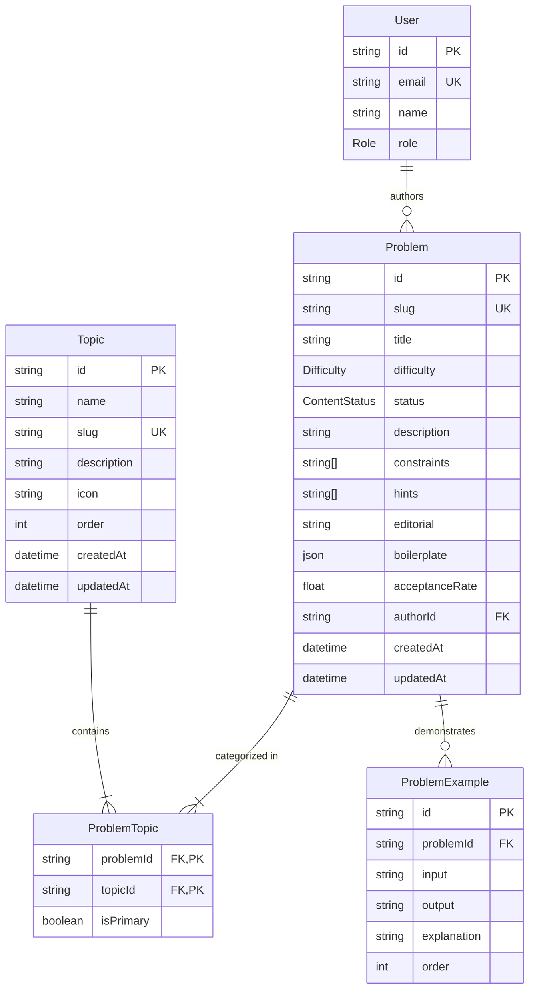

# NUMU Phase 3A — Comprehensive UI Audit, Data Discovery & End-to-End Data Mapping

**Status**: Completed Audit (Stage 3A) — Awaiting Explicit User Approval Before Phase 3B Implementation  
**Auditor**: Staff Software Engineer, Senior Next.js & NestJS Architect, PostgreSQL/Prisma Data Architect  
**Scope**: Full codebase audit of `apps/web`, `apps/api`, `packages/database`, and `packages/types`  

---

## 1. Executive Summary & Repository Verification

This audit provides a factual discovery and mapping of the NUMU repository prior to initiating Phase 3 (DSA Problem Repository, Algorithmic Topics, and Problem Catalog Engine).

### Verified Repository Architecture
- **Monorepo Management**: pnpm `10.32.1` workspaces orchestrated with Turbo `2.3.3`.
- **Frontend (`apps/web`)**: Next.js `15.1.0` (Turbopack, App Router, React 19, Tailwind CSS v4).
- **Backend API (`apps/api`)**: NestJS `11.0.0` modular monolith on Express, Swagger (`/api/docs`), global validation pipe via `class-validator`, Throttler guard (100 req/min).
- **Database (`packages/database`)**: PostgreSQL 17 via Prisma `6.1.0`. Native connection on port `5432`.
- **Shared Contracts (`packages/types`)**: `@numu/types` providing cross-boundary API response envelopes (`ApiResponse<T>`, `PaginatedResponse<T>`, `PaginationMeta`) and user identity types.
- **Server State Management Reality Check**: **TanStack Query is NOT currently installed or configured.** The existing codebase relies on singleton service abstractions (`dsaService`, `profileService`, `bookmarksService`, etc.) calling the custom `apiClient` (`Fetch` API wrapper with `credentials: 'include'`), with local React state (`useState`/`useEffect`).

---

## 2. Frontend Route & Screen Inventory

The audit examined every route and component under `apps/web/src/app` and `apps/web/src/components`:

| Route Path | Page Title / Purpose | Existing Components | Layout / Shared | Data Displayed | Current Data Source | Reusable Components |
|---|---|---|---|---|---|---|
| `/dashboard/dsa` | **DSA Overview & Dashboard**<br>High-level progress, streak, consistency heatmap, weak topics, daily challenge, upcoming test, topic roadmap | `ConsistencyHeatmap`, `SolvedDonut`, `DiffBadge`, Hero Banner with action buttons | `DashboardSidebar`, `DashboardHeader`, RootLayout with `AuthProvider` & `ToastProvider` | - Total solved (147/500)<br>- Easy (72), Medium (58), Hard (17)<br>- Streak (12 days)<br>- Consistency heatmap (21 days)<br>- Next problem (`Container With Most Water`)<br>- Daily Challenge + XP (+50 XP)<br>- 5 Weak topics (DP, Trees, Graphs, etc.)<br>- 8 Topics with completion % | `apps/web/src/data/dsa-mock.ts` (`DSA_STATS`, `DSA_HEATMAP`, `DSA_PRACTICE_PROBLEMS`, `DSA_RECENT_PROBLEMS`, `DSA_WEAK_TOPICS`, `DSA_TOPICS`, `DSA_CONTINUE`, `DSA_DAILY_CHALLENGE`, `DSA_UPCOMING_TEST`) | `DiffBadge`, `ConsistencyHeatmap`, `SolvedDonut`, `dsa-topic-card` |
| `/dashboard/dsa/problems` | **DSA Problem Catalog**<br>Search, multi-dimensional filters, problem list table, status tracking, pagination | Filter Sidebar, SearchBar, StatusIcon, TabBar, Problem Table, Pagination controls | `DashboardSidebar`, `DashboardHeader` | - 15 mock problems displayed<br>- Filter counts: Difficulty (Easy 210, Med 342, Hard 178), Topics (5), Patterns (5), Status (3), Platforms (4), Companies (5)<br>- Problem attributes: ID, Title, Status, Difficulty, Topic, Pattern, Platform, Acceptance %, LeetCode URL, Bookmark toggle | **Local hardcoded constant array** `PROBLEMS` in `apps/web/src/app/dashboard/dsa/problems/page.tsx` (not even hooked to `dsa.service.ts`) | `DiffBadge`, Filter Sidebar layout, Table Row styling, StatusIcon |
| `/dashboard/dsa/patterns` | **Algorithmic Patterns Map**<br>Roadmap of problem-solving patterns grouped by foundation, data structures, techniques | `Donut`, Pattern Group Cards, Progress bars, Tip list | `DashboardSidebar`, `DashboardHeader` | - 4 Pattern categories (Foundation, Data Structures, Advanced Techniques, Graph & DP)<br>- 13 Patterns with difficulty, problem count, mastery % | Local hardcoded constant `PATTERN_GROUPS` in `apps/web/src/app/dashboard/dsa/patterns/page.tsx` | `Donut`, Pattern Card layout |
| `/dashboard` | **Main Student Dashboard**<br>Quick stats, DSA progress ring, recommended problems, daily challenge, tasks | `DsaProgressCard`, `RecommendedPractice`, `DailyChallengeCard`, `ContinueLearningBanner` | `DashboardSidebar`, `DashboardHeader` | - Overall DSA solved & breakdown<br>- 4 Recommended practice problems with categories & bookmarks | `apps/web/src/data/dashboard-mock.ts` | `DsaProgressCard`, `RecommendedPractice` |
| `/dashboard/bookmarks` | **Bookmarks / Saved Items**<br>Lists bookmarked DSA problems, patterns, projects | `EmptyState`, `LoadingState`, Filter pills, Bookmark item card | `DashboardSidebar`, `DashboardHeader`, `PageHeader` | - Saved items with title, subtitle, tag, savedAt timestamp, direct link | `apps/web/src/services/bookmarks.service.ts` via `DUMMY_BOOKMARKS` | `EmptyState`, `LoadingState`, `PageHeader` |
| `/tests/[testId]/attempt` | **Coding & MCQ Test Engine**<br>Monaco Editor, split screen, testcases drawer, runner, language switcher | Monaco `Editor`, Problem description panel, Testcase console drawer, Timer | Fullscreen assessment layout | - Problem statement, markdown description<br>- Input/Output Examples (3)<br>- Constraints (4)<br>- Boilerplate code per language (Python, C++, Java, JS, TS)<br>- Interactive test cases & execution runner | `apps/web/src/data/tests-data.ts` (`DUMMY_TESTS`, `TestQuestion`, `ProblemExample`, `TestCase`) | Monaco Editor container, Collapsible splitter, Testcase tabs drawer |

---

## 3. Frontend Data Flow & Mock Discovery

### 3.1. Existing Service Abstraction
In `apps/web/src/services/dsa.service.ts`:
```typescript
export interface DsaService {
  getOverview(): Promise<DsaOverviewData>;
  getProblems(filters?: { topic?: string; difficulty?: string; search?: string }): Promise<DsaProblem[]>;
  getProblemById(id: string): Promise<DsaProblem | null>;
  toggleBookmark(problemId: string): Promise<DsaProblem[]>;
}
```
- Toggle mechanism: Uses `envConfig.useMocks ? new MockDsaService() : new ApiDsaService()`.
- **Finding**: While `dsaService` exists with full `ApiDsaService` and `MockDsaService`, `/dashboard/dsa/problems/page.tsx` **bypasses** `dsaService` and uses a static hardcoded `PROBLEMS` array in the component file.
- **Finding**: External links point to LeetCode rather than an internal problem solving / details route.
- **Finding**: In `apps/web/src/lib/api/endpoints.ts`, the following endpoints are already pre-cataloged:
  - `ENDPOINTS.DSA.TOPICS = '/dsa/topics'`
  - `ENDPOINTS.DSA.PROBLEMS = '/dsa/problems'`
  - `ENDPOINTS.DSA.PROBLEM_BY_ID = (id) => '/dsa/problems/${id}'`
  - `ENDPOINTS.DSA.PATTERNS = '/dsa/patterns'`
  - `ENDPOINTS.DSA.BOOKMARK = (id) => '/dsa/problems/${id}/bookmark'`

### 3.2. Data Shapes in Mock Data Files
1. `DsaProblem` (`apps/web/src/data/dsa-mock.ts`):
   - `id`: `string`
   - `title`: `string`
   - `difficulty`: `'Easy' | 'Medium' | 'Hard'`
   - `category`: `string`
   - `acceptance`: `string` (e.g. `'52.3%'`)
   - `isSolved`: `boolean`
   - `isBookmarked`: `boolean`
   - `solvedOn`: `string` (optional, e.g. `'Oct 02'`)
2. `DsaTopic` (`apps/web/src/data/dsa-mock.ts`):
   - `label`: `string`
   - `slug`: `string`
   - `icon`: `string`
   - `totalProblems`: `number`
   - `solvedProblems`: `number`
   - `color`: `string`
3. `TestQuestion` & `ProblemExample` (`apps/web/src/types/tests.ts`):
   - `id`: `string`
   - `title`: `string`
   - `difficulty`: `'Easy' | 'Medium' | 'Hard'`
   - `description`: `string`
   - `examples`: `Array<{ input: string; output: string; explanation?: string }>`
   - `constraints`: `string[]`
   - `boilerplate`: `Record<string, string>` (keyed by language: `python`, `cpp`, `java`, `javascript`, `typescript`)
   - `testCases`: `Array<{ input: string; expectedOutput: string }>`

---

## 4. Backend & Database Audit (`apps/api` & `packages/database`)

### 4.1. Existing Database Schema
The database currently contains only Phase 2 identity and access entities in `packages/database/prisma/schema.prisma`:
1. `User`: `id`, `email`, `username`, `name`, `passwordHash`, `role` (`STUDENT`, `TRAINER`, `COLLEGE_ADMIN`, `PLATFORM_ADMIN`), `isActive`, `isEmailVerified`, timestamps.
2. `Profile`: `userId`, `bio`, `headline`, `avatarUrl`, `college`, `gradYear`, `githubUrl`, `linkedinUrl`, `websiteUrl`, `location`, `skills`.
3. `RefreshToken`: Token rotation with family reuse protection.
4. `PasswordResetToken`: Single-use recovery tokens.
5. `Organization`: Multi-tenant college entities (`name`, `slug`, `logoUrl`).
6. `OrganizationMember`: Maps users to organizations (`OWNER`, `ADMIN`, `TRAINER`, `MEMBER`).

**Zero tables currently exist for Problems, Topics, Tags, TestCases, or Submissions.**

### 4.2. Existing Backend Modules
Under `apps/api/src/modules/`:
- `auth`: JWT, Argon2id, cookie serialization, login/register/refresh/logout.
- `health`: System & PostgreSQL connectivity health checks.
- `users`: User retrieval, profile PATCH, platform-admin management.
- `profiles`: Public & private profile aliases.
- `organizations`: Multi-tenant organization CRUD and membership isolation.

**No `problems`, `dsa`, or `topics` module exists yet in the backend.**

---

## 5. Complete Data Dictionary

The following table maps every field rendered on the frontend UI to its frontend type, API contract, and proposed Prisma model.

| Field | UI Route / Component | Frontend Type | API Field | Prisma Model / Field | Required? | Transformation | Access Level | Status |
|---|---|---|---|---|---|---|---|---|
| Problem ID | `/dashboard/dsa/problems` | `string` | `id` | `Problem.id` | Yes | CUID string | Public | **Proposed** |
| Slug | Link / URL navigation | `string` | `slug` | `Problem.slug` | Yes | Kebab-case string (e.g., `two-sum`) | Public | **Proposed** |
| Title | Problem list, detail, overview | `string` | `title` | `Problem.title` | Yes | Raw string | Public | **Proposed** |
| Difficulty | Badge in table, cards, modal | `'EASY' \| 'MEDIUM' \| 'HARD'` | `difficulty` | `Problem.difficulty` (`Difficulty` enum) | Yes | Enum mapping to UI Title Case (`Easy`) | Public | **Proposed** |
| Acceptance Rate | Table column in `/dsa/problems` | `number` / `string` (e.g. `52.3%`) | `acceptanceRate` | `Problem.acceptanceRate` (`Float`) | No | Format as `${val.toFixed(1)}%` | Public | **Proposed** |
| Description / Statement | Problem Details & Assessment | `string` | `description` | `Problem.description` (`Text`) | Yes | Markdown rendered in client | Public | **Proposed** |
| Constraints | Problem Details & Assessment | `string[]` | `constraints` | `Problem.constraints` (`String[]`) | Yes | Direct array | Public | **Proposed** |
| Hints | Problem Details | `string[]` | `hints` | `Problem.hints` (`String[]`) | No | Array of hint strings | Authenticated / Public | **Proposed** |
| Editorial / Solution | Problem Details Tab | `string?` | `editorial` | `Problem.editorial` (`Text?`) | No | Markdown rendered | Authenticated | **Proposed** |
| Code Boilerplate | Code editor initial state | `Record<string, string>` | `boilerplate` | `Problem.boilerplate` (`Json`) | Yes | Keyed by language slug | Public | **Proposed** |
| Examples | Problem Details (`examples`) | `ProblemExampleDto[]` | `examples` | `ProblemExample` table | Yes | Nested entity array | Public | **Proposed** |
| Example Input | Example card | `string` | `input` | `ProblemExample.input` | Yes | Text representation | Public | **Proposed** |
| Example Output | Example card | `string` | `output` | `ProblemExample.output` | Yes | Text representation | Public | **Proposed** |
| Example Explanation | Example card | `string?` | `explanation` | `ProblemExample.explanation` | No | Optional text | Public | **Proposed** |
| Topic ID / Slug | Filter pills & topic cards | `string` | `slug` | `Topic.slug` | Yes | Kebab-case string (e.g., `arrays`) | Public | **Proposed** |
| Topic Name / Label | Filter pills & topic cards | `string` | `name` | `Topic.name` | Yes | String (e.g., `Arrays`) | Public | **Proposed** |
| Topic Icon | Topic cards | `string?` | `icon` | `Topic.icon` | No | Lucide icon name or emoji | Public | **Proposed** |
| Topic Description | Topic page header | `string?` | `description` | `Topic.description` | No | Raw text | Public | **Proposed** |
| Topic Problem Count | Topic cards (`totalProblems`) | `number` | `problemCount` | Computed via `_count.problems` | Yes | Aggregate count integer | Public | **Proposed** |
| Order Index | Ordering topics & examples | `number` | `order` | `Topic.order` / `ProblemExample.order` | Yes | Integer sorting index | Public | **Proposed** |
| Publication Status | Admin / Authoring | `'DRAFT' \| 'PUBLISHED' \| 'ARCHIVED'` | `status` | `Problem.status` (`ContentStatus` enum) | Yes | Enum | Trainer / Admin | **Proposed** |
| Author Reference | Problem metadata | `{ id, name }` | `author` | `Problem.authorId` → `User.id` | Yes | Select `id`, `name`, `username` | Public | **Proposed** |
| User Solved Status | Problem table checkmark | `'SOLVED' \| 'ATTEMPTED' \| 'UNSOLVED'` | `userStatus` | Computed per authenticated user | No | Requires user session | Authenticated | **Proposed (Ph 3B)** |
| User Bookmark | Problem table bookmark icon | `boolean` | `isBookmarked` | Computed / Bookmarks table | No | Default `false` for unauthenticated | Authenticated | **Proposed (Ph 3B)** |
| Created / Updated At | Catalog & Audit | `string` (ISO) | `createdAt`, `updatedAt` | `Problem.createdAt`, `Problem.updatedAt` | Yes | ISO Date string | Public | **Proposed** |
| Pagination Meta | Table bottom pagination | `PaginationMeta` | `pagination` | Computed from `total`, `page`, `limit` | Yes | `{ page, pageSize, total, totalPages }` | Public | **Existing & Verified** (`@numu/types`) |

---

## 6. Entity Relationship Map (Phase 3 Core Data Model)

To cleanly satisfy all requirements without introducing bloat or premature submission-engine complexity:



### Relationships & Integrity Constraints
1. **`User` (Author) → `Problem`**:
   - Cardinality: `1 : N` (One user authors multiple problems).
   - Foreign Key: `Problem.authorId` references `User.id`.
   - On Delete: `RESTRICT` (Prevents deleting users who author platform curriculum).
2. **`Problem` ↔ `Topic` (Many-to-Many via `ProblemTopic`)**:
   - Cardinality: `N : M` (A problem can span multiple algorithmic topics, e.g., `Dynamic Programming` and `Arrays`).
   - Junction Model: `ProblemTopic` with composite primary key `@@id([problemId, topicId])`.
   - `isPrimary`: `Boolean` flag identifying the primary category for catalog listing.
   - On Delete: `Cascade` from both sides.
3. **`Problem` → `ProblemExample`**:
   - Cardinality: `1 : N` (A problem has 1 to 5 public examples).
   - Foreign Key: `ProblemExample.problemId` references `Problem.id`.
   - On Delete: `Cascade`.
   - Order: `order Int @default(0)` for deterministic presentation.

---

## 7. UI-to-Data Traceability Matrix

| Page / Feature | User Action | Data Required | API Endpoint Needed | HTTP Method & Query Params | Auth Required? | Role Policy |
|---|---|---|---|---|---|---|
| **DSA Problems Catalog** (`/dashboard/dsa/problems`) | Filter by difficulty, topic, search query, paginate | Paginated problem list with difficulty, primary topic, acceptance rate, title, slug | `/api/v1/problems` | `GET ?page=1&limit=20&difficulty=MEDIUM&topic=arrays&search=sum` | Public / Optional Auth | Any (Drafts filtered out for non-admins) |
| **Problem Details View** (`/dashboard/dsa/problems/[slug]`) | Open problem to view statement, examples, constraints | Full problem statement, examples, constraints, hints, boilerplate code | `/api/v1/problems/:slug` | `GET /api/v1/problems/two-sum` | Public / Optional Auth | Any (Drafts restricted to `TRAINER`, `PLATFORM_ADMIN`) |
| **Explore DSA Topics** (`/dashboard/dsa`) | View topic cards, completion counts, navigate to filtered problems | List of all active topics with problem counts | `/api/v1/topics` | `GET /api/v1/topics` | Public | Any |
| **Topic Detail Roadmap** (`/dashboard/dsa/topics/[slug]`) | View topic details and list of problems under this topic | Topic metadata + ordered problem list | `/api/v1/topics/:slug` | `GET /api/v1/topics/arrays` | Public | Any |
| **Problem Creation / Authoring** (Admin/Trainer Portal) | Create new DSA problem with examples and boilerplate | Problem DTO with title, description, constraints, boilerplate, topic IDs | `/api/v1/problems` | `POST /api/v1/problems` | Authenticated | `TRAINER`, `PLATFORM_ADMIN` |
| **Problem Update** (Admin/Trainer Portal) | Edit problem statement, constraints, publish status | Partial problem update DTO | `/api/v1/problems/:id` | `PATCH /api/v1/problems/:id` | Authenticated | Author `TRAINER` or `PLATFORM_ADMIN` |

---

## 8. Proposed API Specifications

All endpoints will adhere strictly to NUMU conventions:
- Global prefix: `/api/v1`
- Response wrapper: `ApiResponse<T>` or `PaginatedResponse<T>` from `@numu/types`
- Standard HTTP status codes: `200 OK`, `201 Created`, `400 Bad Request`, `401 Unauthorized`, `403 Forbidden`, `404 Not Found`, `409 Conflict`.

### 8.1. `GET /api/v1/problems` (Problem Catalog)
- **Summary**: Paginated list of published DSA problems with multi-factor filtering.
- **Access**: Public (`@Public()`). If an authenticated user token is present, resolves user's solved/bookmark status.
- **Query Parameters**:
  - `page`: Integer $\ge 1$, default `1`.
  - `limit`: Integer between `1` and `100`, default `20`.
  - `difficulty`: Optional enum (`EASY`, `MEDIUM`, `HARD`).
  - `topic`: Optional topic slug (`string`).
  - `search`: Optional string (case-insensitive title and slug match).
  - `sortBy`: `'popularity' | 'difficulty' | 'acceptance' | 'newest'` (default: `'newest'`).
- **Response Format**:
```json
{
  "success": true,
  "data": [
    {
      "id": "cuid...",
      "slug": "two-sum",
      "title": "Two Sum",
      "difficulty": "EASY",
      "acceptanceRate": 52.3,
      "primaryTopic": {
        "slug": "arrays",
        "name": "Arrays"
      },
      "topics": [
        { "slug": "arrays", "name": "Arrays" },
        { "slug": "hashing", "name": "Hash Map" }
      ],
      "createdAt": "2026-10-16T12:00:00.000Z"
    }
  ],
  "pagination": {
    "page": 1,
    "pageSize": 20,
    "total": 504,
    "totalPages": 26
  }
}
```

### 8.2. `GET /api/v1/problems/:slug` (Problem Details)
- **Summary**: Retrieves complete problem definition for rendering problem statement and coding sandbox.
- **Access**: Public for `PUBLISHED` problems. `TRAINER` or `PLATFORM_ADMIN` required for `DRAFT` status.
- **Parameters**: `slug` (kebab-case unique identifier).
- **Response Format**:
```json
{
  "success": true,
  "data": {
    "id": "cuid...",
    "slug": "two-sum",
    "title": "Two Sum",
    "difficulty": "EASY",
    "status": "PUBLISHED",
    "description": "Given an array of integers `nums`...",
    "constraints": [
      "2 <= nums.length <= 10^4",
      "-10^9 <= nums[i] <= 10^9"
    ],
    "hints": [
      "A really brute force way would be to search for all possible pairs of numbers..."
    ],
    "boilerplate": {
      "python": "class Solution:\n    def twoSum(self, nums: list[int], target: int) -> list[int]:\n        pass",
      "cpp": "class Solution {\npublic:\n    vector<int> twoSum(vector<int>& nums, int target) {\n        \n    }\n};",
      "typescript": "function twoSum(nums: number[], target: number): number[] {\n    \n}"
    },
    "examples": [
      {
        "id": "cuid...",
        "input": "nums = [2,7,11,15], target = 9",
        "output": "[0,1]",
        "explanation": "Because nums[0] + nums[1] == 9, we return [0, 1].",
        "order": 0
      }
    ],
    "topics": [
      { "slug": "arrays", "name": "Arrays" }
    ],
    "author": {
      "id": "cuid...",
      "name": "Sarah Chen",
      "username": "sarahchen"
    },
    "createdAt": "2026-10-15T00:00:00.000Z",
    "updatedAt": "2026-10-15T00:00:00.000Z"
  }
}
```

### 8.3. `GET /api/v1/topics` (Topics Catalog)
- **Summary**: Retrieves all topics with problem counts and metadata for roadmaps and topic navigation cards.
- **Access**: Public.
- **Response Format**:
```json
{
  "success": true,
  "data": [
    {
      "id": "cuid...",
      "slug": "arrays",
      "name": "Arrays",
      "description": "Contiguous memory layout and two-pointer techniques",
      "icon": "▦",
      "order": 1,
      "problemCount": 120
    }
  ]
}
```

### 8.4. Content Management Endpoints (Trainer / Platform Admin)
- `POST /api/v1/problems`: Creates new problem. Guard: `@UseGuards(JwtAuthGuard, RolesGuard)` + `@Roles(Role.TRAINER, Role.PLATFORM_ADMIN)`.
- `PATCH /api/v1/problems/:id`: Updates problem fields or publication status.
- `DELETE /api/v1/problems/:id`: Soft-archives a problem (`status = ARCHIVED`).

---

## 9. Performance & Pagination Design

### 9.1. Pagination Strategy: Offset vs. Cursor
- **Initial Catalog Decision**: **Bounded Offset Pagination (`page`, `limit`)**.
  - **Rationale**: The existing UI renders page number pills (`1, 2, 3, 4, 5 ... 34`), requires jumping to arbitrary pages, and displays total problem counts. Offset pagination directly satisfies this UI contract.
  - **Bounds**: Max limit capped strictly at `100` (`limit = Math.min(Math.max(1, limit), 100)`).
  - **Future Scalability**: When infinite scroll or feeds are introduced, cursor pagination (`take` and `cursor: { id }`) will be added without breaking the offset endpoint.

### 9.2. Query Optimization & Indexing Strategy
To prevent N+1 queries and guarantee sub-20ms database response times under load:
1. **Explicit Field Projections (`select` vs `include`)**:
   - In catalog listing (`GET /api/v1/problems`), **never** select the heavy `description`, `editorial`, `hints`, or `boilerplate` columns. Only project lightweight fields needed for the table row.
2. **Compound & Covering Indexes**:
   - `@@index([status, difficulty])` — for instant filtered listing.
   - `@@index([status, createdAt])` — for default deterministic sorting.
   - `@@unique([slug])` — ensures O(1) slug lookups for detail pages.
   - Junction index `@@index([topicId, problemId])` — eliminates sequential table scans during topic filtering.
3. **Database Aggregates for Counts**:
   - Topic problem counts computed in a single query via Prisma's `_count: { select: { problems: { where: { problem: { status: 'PUBLISHED' } } } } }`.

---

## 10. Role-Based Access Control (RBAC) Matrix

| Operation | `STUDENT` | `TRAINER` | `COLLEGE_ADMIN` | `PLATFORM_ADMIN` |
|---|---|---|---|---|
| Read Published Problems & Topics | ✅ Allowed | ✅ Allowed | ✅ Allowed | ✅ Allowed |
| Read Draft / Unpublished Problems | ❌ 403 Forbidden | ✅ Allowed (Own & Curriculum) | ❌ 403 Forbidden | ✅ Allowed (All) |
| Create Problems (`POST /problems`) | ❌ 403 Forbidden | ✅ Allowed | ❌ 403 Forbidden | ✅ Allowed |
| Edit Problems (`PATCH /problems/:id`) | ❌ 403 Forbidden | ✅ Allowed (If author or co-trainer) | ❌ 403 Forbidden | ✅ Allowed |
| Publish / Unpublish Problems | ❌ 403 Forbidden | ✅ Allowed | ❌ 403 Forbidden | ✅ Allowed |
| Create / Edit Topics | ❌ 403 Forbidden | ❌ 403 Forbidden | ❌ 403 Forbidden | ✅ Allowed |

---

## 11. Shared Contracts Architecture (`packages/types`)

To prevent duplicate definitions and type drift, the contract boundary is partitioned as follows:

1. **`packages/types` (`@numu/types`)**:
   - `ProblemDifficulty` enum (`'EASY' | 'MEDIUM' | 'HARD'`).
   - `ContentStatus` enum (`'DRAFT' | 'PUBLISHED' | 'ARCHIVED'`).
   - `ProblemListItem` (lightweight row for catalog table).
   - `ProblemDetail` (full problem with statement, examples, and boilerplate).
   - `ProblemExampleDto` (`input`, `output`, `explanation`).
   - `TopicItem` (`id`, `slug`, `name`, `icon`, `problemCount`).
   - `CreateProblemDto` / `UpdateProblemDto`.
2. **`packages/database` (`@numu/database`)**:
   - Owns the physical Prisma schema, migrations, and database seeders.
   - Frontend **never** imports `@prisma/client`.
3. **`apps/web`**:
   - Imports shared DTOs and contracts from `@numu/types`.
   - Wires `dsaService` to `@/lib/api/endpoints` using the central `apiClient`.

---

## 12. Migration Implications

- **Forward Compatible**: Adding `Problem`, `Topic`, `ProblemTopic`, and `ProblemExample` models does not alter existing `User`, `Profile`, or `Organization` tables.
- **Reference**: A new relation `User.authoredProblems Problem[]` will be added cleanly to `User`.
- **Database Engine**: PostgreSQL 17 handles the composite primary key and text arrays natively.

---

## 13. Comprehensive Test Plan for Phase 3

1. **Unit Tests (`apps/api`)**:
   - `problems.service.spec.ts`: Test slug uniqueness generation, draft visibility isolation, filter building, and pagination edge cases.
   - `topics.service.spec.ts`: Test topic creation, ordering, and problem count aggregation.
2. **Automated E2E API Tests (`apps/api/test-e2e-problems.js`)**:
   - Similar to Phase 2 `test-e2e-api.js`, verify:
     - Public listing with pagination.
     - Case-insensitive search.
     - Difficulty & topic filtering.
     - RBAC enforcement (Students rejected from creating problems with 403).
     - Single-slug lookup with examples and constraints.
3. **Frontend Integration Tests (`apps/web`)**:
   - Wire `/dashboard/dsa/problems/page.tsx` to `dsaService.getProblems()`.
   - Verify filter sidebar state triggers API requests.
   - Verify empty state when no problems match search criteria.
   - Verify loading spinner during pagination.

---

## 14. Unresolved Decisions & Product Alignment

1. **Decision 1: Platform vs External LeetCode Links**:
   - *Current State*: `/dashboard/dsa/problems` links out to LeetCode URLs directly.
   - *Recommendation*: Introduce an internal problem details/solving route (`/dashboard/dsa/problems/[slug]`) that reuses the Monaco editor and layout from `/tests/[testId]/attempt`, with an optional "Open in LeetCode" secondary link.
2. **Decision 2: Institutional / Organization Problem Privacy**:
   - *Current State*: The platform has an `Organization` table for colleges.
   - *Recommendation for Phase 3*: Keep problems platform-wide for now (`isGlobal: true`). College-restricted problems should be deferred to a later phase to maintain simplicity.
3. **Decision 3: Server-State Library (TanStack Query)**:
   - *Current State*: TanStack Query is not currently installed.
   - *Recommendation*: Use standard React `useEffect` + service pattern consistent with existing Phase 1 & 2 codebase (`profileService`, `authService`). If TanStack Query is desired, it should be introduced in a dedicated infrastructure upgrade rather than mixed into Phase 3.

---

## 15. Recommended Step-by-Step Part B Implementation Order

Following explicit approval:
1. **Step 1: Database Schema Expansion (`packages/database`)**:
   - Add `Difficulty` and `ContentStatus` enums.
   - Add `Topic`, `Problem`, `ProblemTopic`, and `ProblemExample` models.
   - Generate migration: `20261016_init_dsa_problems_and_topics`.
   - Expand database seed script with canonical problem set (Two Sum, Valid Parentheses, Container With Most Water, 3Sum, Reverse Linked List, etc.).
2. **Step 2: Shared Contracts Export (`packages/types`)**:
   - Export DSA DTOs and contracts in `@numu/types`.
3. **Step 3: Backend Modules Implementation (`apps/api`)**:
   - Implement `TopicsModule` (Controller, Service, DTOs).
   - Implement `ProblemsModule` (Controller, Service, DTOs, Query filters, RBAC guards).
   - Register modules in `AppModule`.
4. **Step 4: Automated E2E Verification**:
   - Write and run `apps/api/test-e2e-problems.js` to ensure 100% test pass rate.
5. **Step 5: Frontend Integration (`apps/web`)**:
   - Connect `ApiDsaService` to new `/api/v1/problems` and `/api/v1/topics` endpoints.
   - Wire `/dashboard/dsa/problems/page.tsx` to real API client with search, filters, and pagination.
   - Wire `/dashboard/dsa/page.tsx` topics to live topic counts.
   - Add reusable problem detail view with statement, examples, and constraints.
