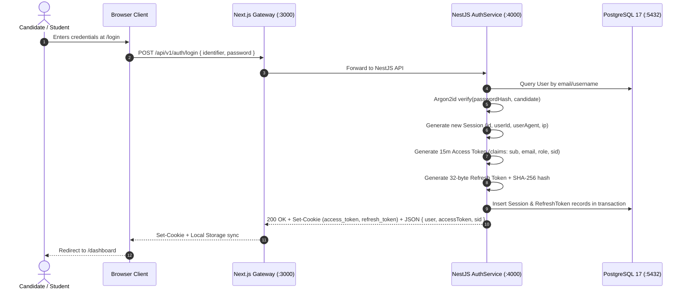
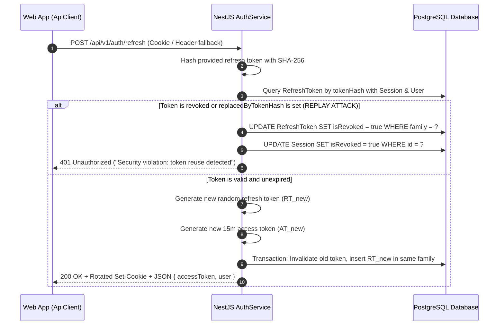

# NUMU Authentication Architecture & Security Specifications

**Version:** 1.0.0  
**Status:** Approved & Target Architecture  
**Author:** NUMU Core Security & Architecture Engineering Team

---

## 1. Architectural Strategy & Design Decisions

NUMU employs a **Hybrid Token-Based Authentication Architecture with Server-Side Session Tracking**. This architecture provides the stateless scalability of signed JSON Web Tokens for API authorization combined with the precise revocation, device tracking, and replay protection of stateful server-side sessions.

### Core Architectural Decisions & Trade-Offs

| Decision | Chosen Approach | Alternative Considered | Rationale & Trade-Off |
|---|---|---|---|
| **Primary Credential Delivery** | HttpOnly, SameSite, Secure Cookies | LocalStorage-only tokens | HttpOnly cookies cannot be accessed by client-side JavaScript, eliminating the risk of token theft via Cross-Site Scripting (XSS). |
| **API Client Proxying** | Next.js API Rewrites (`/api/v1/*`) | Cross-origin CORS with wildcard origins | Rewrites maintain a single-origin relationship between browser and API in browser contexts, eliminating cross-origin cookie dropping and CORS preflight overhead. |
| **Access Token Lifetime** | Short-lived (15 minutes) | Long-lived (7 days) | Limits the window of vulnerability if an access token is leaked. Revocation propagation happens within at most 15 minutes without requiring centralized database lookups on every single micro-request. |
| **Refresh Token Strategy** | Cryptographic random strings, hashed in DB with atomic rotation | Reusable signed JWT refresh tokens | Rotating on each use and storing SHA-256 digests enables immediate revocation, family-based replay attack detection, and eliminates token theft windows. |
| **Session Model** | Relational `Session` entity in PostgreSQL | In-memory Redis sessions | Storing sessions in PostgreSQL provides strict transactional ACID guarantees with zero synchronization drift or data loss across server restarts. |

---

## 2. Authentication Flow & State Transitions

### 2.1 User Login & Initial Session Establishment


### 2.2 Refresh Token Rotation with Replay Attack Detection
When the 15-minute access token expires, the client API layer automatically initiates token rotation:


---

## 3. Token Specifications & Claims Schema

### 3.1 Access Token (JWT)
- **Algorithm**: `HS256` (HMAC with SHA-256)
- **Header**:
  ```json
  {
    "alg": "HS256",
    "typ": "JWT"
  }
  ```
- **Payload Schema**:
  ```typescript
  interface JwtPayload {
    sub: string;        // User ID (cuid)
    email: string;      // User email address
    username: string | null;
    role: Role;         // STUDENT | TRAINER | COLLEGE_ADMIN | PLATFORM_ADMIN
    sid: string;        // Active Session ID for targeted revocation
    iat: number;        // Issued At timestamp
    exp: number;        // Expiration timestamp (iat + 900s)
    jti: string;        // Unique JWT ID (UUID v4)
  }
  ```

### 3.2 Refresh Token
- **Format**: 32 cryptographically secure random bytes generated via `crypto.randomBytes(32).toString('hex')` (64 characters).
- **Storage**: Never stored in plaintext. Persisted as `SHA-256(raw_token)` hex digest (`tokenHash`).
- **Family Key**: Unique `family` identifier linking rotated generations of a single session.

---

## 4. Session Persistence & Revocation Invariants

1. **Atomic Invalidation**: When a refresh token is used, it is atomically invalidated and linked to the replacement token hash (`replacedByTokenHash`) within an ACID database transaction.
2. **Replay Invalidation**: Any presentation of a previously replaced or revoked refresh token triggers immediate revocation of the **entire token family and parent session**.
3. **Session Revocation**:
   - `DELETE /api/v1/auth/sessions/:sessionId`: Instantly revokes the session.
   - `POST /api/v1/auth/logout-all`: Instantly revokes all active sessions for the authenticated user.
4. **Password Change Invalidation**: Updating account credentials invalidates all existing sessions except optionally the issuing session.

---

## 5. Security Invariants & Compliance Rules

- **Zero Plaintext Secrets**: Passwords hashed with Argon2id; refresh tokens hashed with SHA-256.
- **Timing Attack Mitigation**: When a user is not found during login, a dummy verification cycle against a constant Argon2id hash is executed.
- **Server-Authoritative Enforcement**: Frontend route guards are UX conveniences; every backend endpoint enforces `JwtAuthGuard` and `RolesGuard`.
- **Scoped Privileges**: Registration is strictly locked to `Role.STUDENT`. Privileged roles (`TRAINER`, `COLLEGE_ADMIN`, `PLATFORM_ADMIN`) must be explicitly provisioned by a platform administrator.
