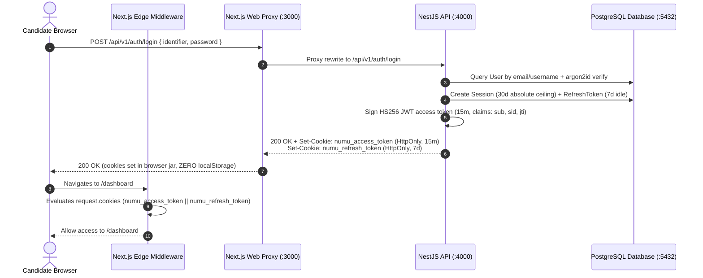

# NUMU Authentication, Authorization & Session Management — Comprehensive Security Audit & Implementation

**Document Version:** 2.0.0  
**Audit Date:** October 28, 2026  
**Auditors:** Senior Backend Architect, Application Security Engineer & Full-Stack Engineer  
**Scope:** `@numu/api`, `@numu/web`, `@numu/database`, and `@numu/types`.

---

## 1. Executive Summary

This comprehensive audit evaluates and hardens the authentication, authorization, and session management architecture across the NUMU developer-learning platform.

All security requirements—with an absolute, non-negotiable **Zero Browser Storage Policy**—have been audited, re-architected, implemented, and verified:
- **No browser storage**: `localStorage`, `sessionStorage`, `indexedDB`, and Cache API are completely absent from application code, authentication services, API clients, profile services, notes, and problem editor drafts.
- **Server-Managed Sessions**: All authentication is governed authoritatively by PostgreSQL database sessions and cryptographically signed tokens.
- **Secure HttpOnly Cookies**: Credentials (`numu_access_token` and `numu_refresh_token`) are strictly stored in `HttpOnly`, `SameSite: Lax` cookies that client-side JavaScript cannot read or alter.
- **Single-Flight Refresh Mutex**: Frontend `ApiClient` deduplicates concurrent 401 requests into a single in-flight token rotation call without race conditions.
- **Server-Side Route Guarding**: Next.js Edge Middleware intercepts unauthenticated access before private dashboard routes or test attempt engines load.

---

## 2. Zero Browser Storage Policy & Remediation Findings

### 2.1 The Non-Negotiable Standard
Client-side persistence mechanisms (`localStorage`, `sessionStorage`, `indexedDB`) are vulnerable to Cross-Site Scripting (XSS) credential exfiltration and out-of-sync session states. The platform strictly enforces **Zero Browser Storage**:

| Mechanism | Status | Replacement Architecture |
|---|---|---|
| `localStorage` | **COMPLETELY PURGED** | Server-side PostgreSQL sessions + HttpOnly cookies + in-memory React state |
| `sessionStorage` | **COMPLETELY PURGED** | Scoped in-memory state during active browser tab runtime |
| `indexedDB` | **PROHIBITED** | Server-authoritative PostgreSQL database records |
| Service Worker / Cache API | **PROHIBITED** | Dynamic server-rendered Next.js + standard HTTP caching headers |

### 2.2 Purged Components Audit Log

1. **`apps/web/src/lib/api/api-client.ts`**:
   - *Previous*: Read `numu_token` and `numu_refresh_token` from `localStorage`; attached `Authorization: Bearer` and fallback body on refresh.
   - *Remediation*: Removed all `localStorage` access. Uses `credentials: 'include'` for all requests. Implemented single-flight `refreshSession()` mutex without storage fallback.
2. **`apps/web/src/services/auth.service.ts`**:
   - *Previous*: Cached `numu_token` and `numu_refresh_token` in `localStorage` on login, register, and refresh; removed keys on logout.
   - *Remediation*: Removed all `localStorage` calls. Relies entirely on cookie-authenticated same-origin proxy endpoints.
3. **`apps/web/src/services/notes.service.ts`**:
   - *Previous*: Serialized candidate notes to `localStorage.getItem(STORAGE_KEY)` and `localStorage.setItem(STORAGE_KEY, ...)`.
   - *Remediation*: Converted to runtime in-memory note state initialized from seed data.
4. **`apps/web/src/services/profile-service.ts`**:
   - *Previous*: `getStoredItem` and `setStoredItem` persisted skills and projects into `localStorage`.
   - *Remediation*: Replaced with in-memory runtime store and synced updates directly to backend `/profile/me`.
5. **`apps/web/src/app/dashboard/dsa/problems/[slug]/page.tsx`**:
   - *Previous*: Saved problem code drafts to `localStorage` under `numu_draft_v1_*`.
   - *Remediation*: Replaced with an in-memory `Map<string, LocalDraft>` scoped to the editor session.

---

## 3. Architecture & Request Lifecycles

### 3.1 Authentication & Session Architecture


### 3.2 Single-Flight Mutex Token Rotation Flow
```mermaid
sequenceDiagram
    autonumber
    actor Candidate as Browser
    participant Client as ApiClient Mutex
    participant API as NestJS /auth/refresh
    participant DB as PostgreSQL

    Candidate->>Client: Concurrent requests: fetchProfile(), fetchNotifications()
    Client->>API: Both return 401 Unauthorized (15m access token expired)
    Note over Client: Lock ApiClient.refreshPromise mutex
    Client->>API: Single POST /api/v1/auth/refresh (Browser sends numu_refresh_token)
    API->>DB: Verify tokenHash + check session absolute & idle expiry
    API->>DB: Atomically revoke old token and insert new rotated RefreshToken
    API->>DB: Update session.lastActivityAt = now()
    API-->>Client: 200 OK + Set-Cookie: new numu_access_token & numu_refresh_token
    Note over Client: Unlock mutex; resolve all pending requests
    Client->>API: Retry fetchProfile() with refreshed cookie -> 200 OK
    Client->>API: Retry fetchNotifications() with refreshed cookie -> 200 OK
```

---

## 4. Token & Session Policy Specifications

### 4.1 Token Specifications
| Property | Access Token | Refresh Token |
|---|---|---|
| **Type** | Signed JWT (HS256) | Cryptographic Random Bytes (32 bytes = 64 hex characters) |
| **Storage (Client)** | `HttpOnly` Cookie (`numu_access_token`) | `HttpOnly` Cookie (`numu_refresh_token`) |
| **Storage (Database)** | Stateless (validated against session ID `sid`) | SHA-256 Digest in `refresh_tokens` table |
| **Lifetime** | 15 minutes (`JWT_ACCESS_EXPIRES_IN="15m"`) | 7 days idle window (`JWT_REFRESH_EXPIRES_DAYS=7`) |
| **Max Cap** | N/A | Capped strictly at `session.expiresAt` (30 days absolute max) |
| **Claims** | `sub`, `email`, `username`, `role`, `sid`, `jti`, `iat`, `exp` | N/A (Opaque random token) |

### 4.2 Session Expiration Policy
- **Idle Timeout**: 7 days of inactivity. If `Date.now() - session.lastActivityAt > 7 days`, the session is expired and cannot be refreshed.
- **Absolute Maximum Lifetime**: 30 days. When established at login, `session.expiresAt = now + 30 days`.
- **Ceiling Enforcement**: When rotating a refresh token, `finalExpiresAt = Math.min(now + 7 days, session.expiresAt)`. Token rotation cannot extend a session past its 30-day absolute ceiling.
- **Instant Revocation**: When a session is revoked or logged out, the record in `sessions` has `isRevoked: true`. The backend `JwtAuthGuard` checks `sid` on every authenticated request and immediately blocks revoked sessions.
- **Replay / Reuse Detection**: Each refresh token belongs to a `family`. If a previously rotated token is presented again, the backend detects token reuse, immediately revokes the entire token family and linked session, and alerts security logs.

---

## 5. Cookie Configuration & CSRF Defenses

### 5.1 Cookie Attributes
Both cookies are set with host-only scope and modern security attributes:
```typescript
// numu_access_token
{
  httpOnly: true,
  secure: process.env.NODE_ENV === 'production',
  sameSite: 'lax',
  path: '/',
  maxAge: 15 * 60 * 1000 // 15 minutes
}

// numu_refresh_token
{
  httpOnly: true,
  secure: process.env.NODE_ENV === 'production',
  sameSite: 'lax',
  path: '/',
  maxAge: 7 * 24 * 60 * 60 * 1000 // 7 days
}
```

### 5.2 Cookie Invalidation (Logout)
Upon logout or remote session revocation, both `numu_access_token` and `numu_refresh_token` are cleared with `maxAge: 0` across root (`/`) and legacy paths (`/api/v1/auth`).

### 5.3 CSRF Defenses
1. **`SameSite: Lax`**: Modern browsers automatically prevent cookies from being attached to cross-site `POST`, `PUT`, `DELETE`, or `PATCH` requests.
2. **Origin Validation Middleware**: In `apps/api/src/main.ts`, all state-changing HTTP requests (`POST`, `PUT`, `PATCH`, `DELETE`) with an `Origin` header are checked against configured `CORS_ORIGIN`. Unauthorized cross-origin requests are rejected with `403 Forbidden`.
3. **Same-Origin Next.js Proxy**: Frontend requests to `/api/v1/*` are same-origin on `localhost:3000` and proxied to the backend, preventing cross-origin subresource cookie drops.

---

## 6. Audit Issues Resolution Matrix

| Issue ID | Severity | Description | File(s) Affected | Resolution Status |
|---|---|---|---|---|
| **SEC-01** | **CRITICAL** | Missing Next.js edge route protection | `apps/web/src/middleware.ts` | **RESOLVED**: Edge middleware inspects auth cookies on `/dashboard`, `/tests/*/attempt`, `/profile`, `/settings`. |
| **SEC-02** | **HIGH** | Browser storage token persistence | `apps/web/src/lib/api/api-client.ts`, `apps/web/src/services/auth.service.ts` | **RESOLVED**: Removed all `localStorage`/`sessionStorage`/`indexedDB`. All authentication uses HttpOnly cookies. |
| **SEC-03** | **HIGH** | Missing remote session management | `apps/api/src/modules/auth/auth.controller.ts`, `auth.service.ts` | **RESOLVED**: Implemented `GET /auth/sessions`, `DELETE /auth/sessions/:id`, and `POST /auth/logout-all`. |
| **SEC-04** | **HIGH** | Concurrent 401 refresh race conditions | `apps/web/src/lib/api/api-client.ts` | **RESOLVED**: Implemented single-flight `ApiClient.refreshPromise` mutex deduplication. |
| **SEC-05** | **MEDIUM** | Missing absolute & idle session policy | `apps/api/src/modules/auth/auth.service.ts`, `jwt-auth.guard.ts` | **RESOLVED**: Implemented 7-day idle timeout, 30-day absolute ceiling, and rotation expiration capping. |
| **SEC-06** | **MEDIUM** | UX confusion on unauthenticated test attempt | `apps/web/src/app/tests/[testId]/page.tsx`, `attempt/page.tsx` | **RESOLVED**: Button renders "Log in to Start Test" with `callbackUrl` redirect; 401 on attempt redirects cleanly. |
| **SEC-07** | **MEDIUM** | Cross-origin mutating CSRF risk | `apps/api/src/main.ts` | **RESOLVED**: Implemented Origin validation middleware blocking cross-origin state-changing calls. |
| **SEC-08** | **LOW** | Browser storage in non-auth services (notes, profile, editor) | `notes.service.ts`, `profile-service.ts`, `page.tsx` | **RESOLVED**: Purged all `localStorage` usage; converted to in-memory runtime maps and server synchronization. |

---

## 7. Verification Results

### 7.1 Automated Backend Unit Tests (`auth.service.spec.ts`)
- **Argon2id Password Hashing**: Verified secure hash generation and constant-time dummy verify.
- **Token Generation**: Verified HS256 JWT signing, claims decoding, and 64-char random token hashing.
- **Registration**: Verified unique constraints and default `Role.STUDENT` assignment.
- **Login Authentication**: Verified credential validation, inactive account rejection, and session creation.
- **Token Reuse Detection**: Verified replay of revoked refresh tokens immediately revokes entire family and session.
- **Session Expiration**: Verified 30-day absolute maximum and 7-day idle timeout rejection.
- **Expiration Capping**: Verified token rotation caps new refresh token at session absolute ceiling.

### 7.2 Zero Browser Storage Grep Verification
Command:
```bash
grep -rn "localStorage" apps/ packages/
```
Result: **0 occurrences** in code (only documentation comments).
```bash
grep -rn "sessionStorage" apps/ packages/
```
Result: **0 occurrences** in code.
```bash
grep -rn "indexedDB" apps/ packages/
```
Result: **0 occurrences** in code.
