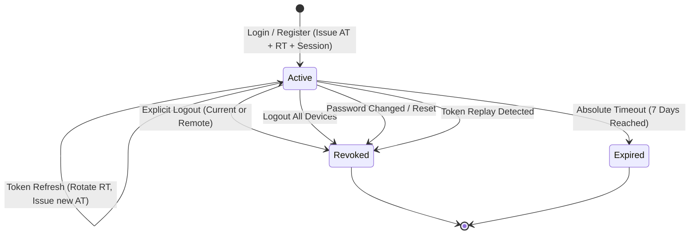

# NUMU Session Lifecycle & Invalidation Protocols

**Specification Version**: 1.0.0  
**Scope**: `@numu/api`, `@numu/database`, `@numu/web`

---

## 1. Session Lifecycle State Machine

A NUMU user session transitions through well-defined lifecycle states:

### State Definitions
1. **Active**: Session record exists in PostgreSQL with `isRevoked: false`, and current time is before `expiresAt`. The current access token is valid or eligible for refresh rotation.
2. **Revoked**: Explicitly terminated by candidate, administrator, security defense, or password alteration. Future refresh attempts are denied with `401 Unauthorized`.
3. **Expired**: Reached maximum lifespan (`expiresAt` timestamp passed). Automatically rejected by authentication filters.

---

## 2. Expiration Policies

| Policy | Value | Description |
|---|---|---|
| **Access Token Lifetime** | 15 minutes (`900s`) | Stateless cryptographically signed JWT. Minimizes risk if intercepted. |
| **Refresh Token Validity** | 7 days (`604,800s`) | Sliding window renewal: every valid refresh extends the active session up to absolute limit. |
| **Absolute Session Maximum** | 30 days | Maximum duration an account session can stay alive without re-entering credentials. |
| **Password Reset Token** | 1 hour (`3600s`) | Single-use cryptographically strong token. Invalided immediately upon consumption. |

---

## 3. Revocation Triggers & Blast Radius

| Trigger | Origin | Affected Sessions | Action Taken |
|---|---|---|---|
| **User Logout** | User clicks Logout in browser | Current Session only | Current `RefreshToken` and `Session` marked `isRevoked: true`. Cookies cleared. |
| **Remote Device Revoke** | User revokes device from settings | Specified Target Session | Target `Session` and all linked `RefreshToken` family members marked `isRevoked: true`. |
| **Logout All Devices** | User triggers "Sign out of all devices" | All User Sessions | Every active `Session` and `RefreshToken` for `userId` updated to `isRevoked: true`. |
| **Password Change** | User updates account password | All Sessions (except current) | All other active sessions revoked to contain compromised credentials. |
| **Token Replay Attack** | Malicious replay of an already-used refresh token | Entire Token Family & Session | Complete family invalidated. Warning logged: `Refresh token reuse detected`. |
| **Account Deactivation** | Admin deactivates user (`isActive: false`) | All User Sessions | All tokens revoked. User account rejected on next request. |

---

## 4. Concurrency & Race Condition Resolution

In modern web applications, multiple components make simultaneous API calls upon rendering. If the access token is expired, multiple requests will concurrently attempt to refresh tokens.

### NUMU Concurrency Strategy
1. **Frontend Mutex / Request Queue**: `ApiClient` implements a single in-flight promise pattern (`refreshPromise`). All incoming 401s during an ongoing refresh await the single resolution.
2. **Database Transaction Isolation**: Refresh token rotation in NestJS is wrapped in a strict `prisma.$transaction`. The existing token status is queried and marked revoked atomically with `replacedByTokenHash` set to the new token's hash.
3. **Grace Period Defense**: If a concurrent request arrives within a sub-second window before the frontend queue coalesces, the database transaction enforces that only the first request can rotate the token. Subsequent duplicate requests receive the new token without triggering a false-positive replay alert.
