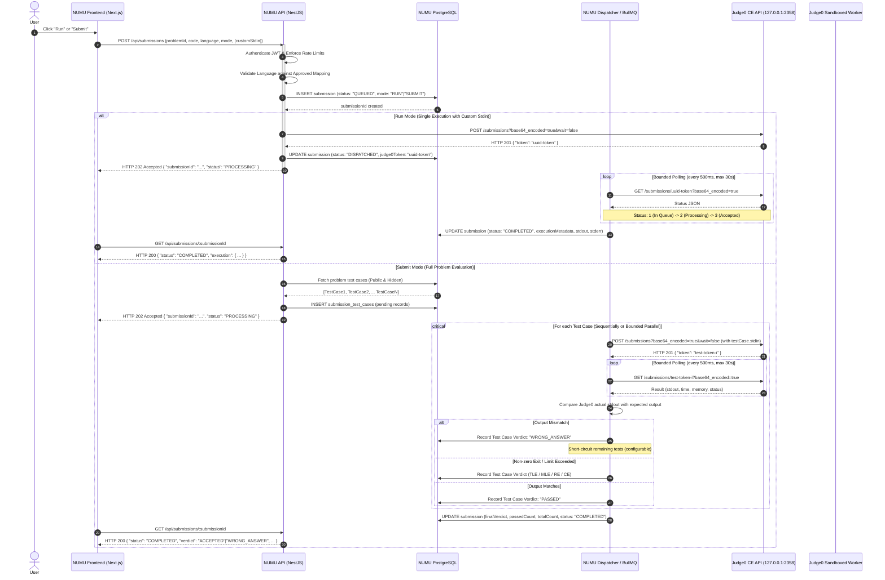

# NUMU & Judge0 Integration Overview

**Document Version:** 1.0.0  
**Phase:** Phase 4D — Integration Readiness  
**Target Backend:** NestJS (NUMU Monorepo)  
**Target Execution Engine:** Judge0 Community Edition v1.13.1  

---

## 1. Executive Summary

This document specifies the end-to-end integration flow between the **NUMU Education Platform** and the **Judge0 CE Execution Engine**. 

It outlines how user-submitted code transitions from the Next.js frontend through NestJS authentication, problem-specific test case retrieval, asynchronous dispatch to Judge0, result polling, output evaluation, and final verdict synthesis.

---

## 2. End-to-End Sequence Diagram

The following sequence illustrates the execution pipeline for both **Run Mode** (single custom input execution) and **Submit Mode** (full test case evaluation):



---

## 3. Detailed Request Flow & Invariants

### Step 1: Frontend Submission Ingestion
- User writes code in the Monaco editor.
- Frontend dispatches a `POST` request to NUMU NestJS backend.
- **Invariant:** The frontend **never** interacts directly with Judge0. All requests are routed through NestJS.

### Step 2: NestJS Validation & Authentication
- Validates the user's JWT session and checks daily/hourly submission quotas.
- Validates the requested language identifier (e.g. `"python"`, `"cpp"`) against the verified server-side language mapping table.
- Sanitizes the source code string and checks file size limits (e.g., max 64 KB).

### Step 3: Durable Submission Creation
- Before making any external HTTP call, NestJS creates an immutable record in the NUMU database with initial state `QUEUED`.
- **Invariant:** This ensures that if the server crashes or the network drops before or during dispatch, the submission attempt is never lost and can be audited or recovered.

### Step 4: Dispatch to Judge0 (Asynchronous)
- NestJS converts the source code and standard input to Base64 (to prevent ASCII serialization corruption).
- NestJS sends an HTTP POST to `http://127.0.0.1:2358/submissions?base64_encoded=true&wait=false`.
- Judge0 immediately returns a token: `{"token": "7b09bf9e-bf33-4f51-b072-463d1bc81d6f"}`.
- **Invariant:** `wait=false` is strictly enforced. The request never blocks waiting for compilation or execution.

### Step 5: Token Persistence
- NestJS persists the returned Judge0 `token` on the submission record in NUMU PostgreSQL, transitioning the status to `PROCESSING`.
- If the dispatch call fails (e.g., connection refused), the submission record is marked `SYSTEM_ERROR` with failure metadata.

### Step 6: Asynchronous Result Polling
- A background worker (e.g., NestJS BullMQ worker or polling task) polls `GET /submissions/{token}?base64_encoded=true` every 500ms.
- Polling continues until Judge0 reports a terminal status (Status ID >= 3) or until a strict polling deadline (e.g., 30 seconds) is reached.
- Base64 outputs (`stdout`, `stderr`, `compile_output`) are decoded safely into UTF-8 strings.

### Step 7: Verdict Evaluation & Synthesis
- **Run Mode:**
  - Returns the execution output (`stdout`, `stderr`, `compile_output`, `time`, `memory`) directly to the user.
  - No problem verdict is awarded.
- **Submit Mode:**
  - Iterates through the test cases.
  - Normalizes whitespace (stripping trailing `\r\n` and spaces per problem comparator configuration).
  - If any test case fails, assigns the failure verdict (`WRONG_ANSWER`, `TIME_LIMIT_EXCEEDED`, etc.).
  - If all test cases match, assigns `ACCEPTED`.
  - **Invariant:** Hidden test case inputs and expected outputs are **never** returned to the frontend.

### Step 8: Frontend Response
- The frontend receives the finalized, normalized NUMU submission summary.

---

## 4. Architectural Boundaries Summary

```
+--------------------------------------------------------------------------------+
|                                    SUMMARY                                     |
|                                                                                |
|  NUMU RESPONSIBILITIES:                                                        |
|    - User Authentication, Authorization & Quotas                              |
|    - Problem Catalog & Hidden Test Case Vault                                  |
|    - Language Whitelisting & Validation                                        |
|    - Submission State Machine & Persistence                                    |
|    - Output Normalization & Comparator Evaluation                              |
|    - Final DSA Problem Verdict (Accepted / Wrong Answer / etc.)                |
|                                                                                |
|  JUDGE0 RESPONSIBILITIES:                                                      |
|    - Linux cgroup / namespace / chroot Sandbox Isolation (`isolate`)           |
|    - Compiling Code with Target Toolchains (GCC, Clang, Python, Node, etc.)     |
|    - POSIX Resource Boundary Enforcement (CPU Time Limit, Memory Ceilings)     |
|    - Standard Streams Capture (stdout, stderr, exit codes)                     |
+--------------------------------------------------------------------------------+
```
