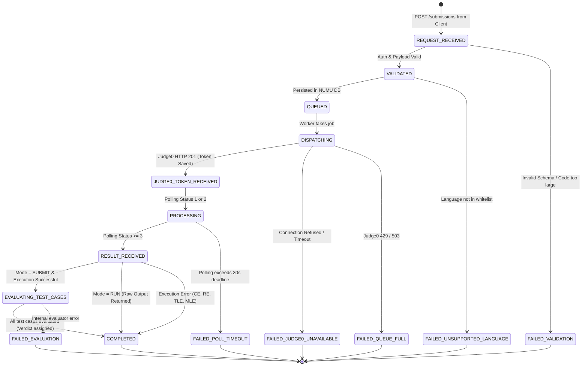

# Submission Lifecycle & State Machine Specification

**Document Version:** 1.0.0  
**Phase:** Phase 4D — Integration Readiness  
**Target:** NUMU NestJS Submission Pipeline & State Machine  

---

## 1. Overview & State Ownership

A robust execution system requires clear separation between **NUMU Submission Lifecycle States** (persisted in NUMU's PostgreSQL database) and **Judge0 Execution States** (transient engine statuses).

```
+----------------------------------------------------------------------------------------------------+
|                                    STATE DOMAIN OWNERSHIP                                          |
|                                                                                                    |
|  NUMU APPLICATION STATE MACHINE:                                                                   |
|    - Tracks user ownership, problem context, test case results, and platform verdicts.             |
|    - Persisted durably in NUMU PostgreSQL across server reboots.                                   |
|    - States: REQUEST_RECEIVED, VALIDATED, QUEUED, DISPATCHING, PROCESSING, EVALUATING, COMPLETED   |
|                                                                                                    |
|  JUDGE0 ENGINE TRANSIENT STATE:                                                                    |
|    - Tracks container sandbox lifecycle, compilation subprocess, and resource watchdog.            |
|    - Stored ephemerally in Judge0 Redis / DB.                                                      |
|    - States: In Queue (1), Processing (2), Accepted (3), TLE (5), CE (6), RE (11), etc.            |
+----------------------------------------------------------------------------------------------------+
```

---

## 2. Complete Lifecycle State Diagram



---

## 3. Step-by-Step Lifecycle Description

### Phase 1: Ingestion & Validation
1. **`REQUEST_RECEIVED`:** Client sends HTTP POST. NestJS intercepts the request.
2. **`VALIDATED`:** NestJS validates JWT token, ensures user hasn't breached rate limits, and validates that `language` matches an active entry in `SUPPORTED_LANGUAGES`.
3. **Failure Path (`FAILED_VALIDATION` / `FAILED_UNSUPPORTED_LANGUAGE`):** Immediate `400 Bad Request` returned to client. No database submission record is created.

### Phase 2: Durable Submission Creation
4. **`QUEUED`:** NestJS creates a record in the NUMU database with status `QUEUED`, capturing `userId`, `problemId`, `language`, `sourceCode`, and `mode` (`RUN` or `SUBMIT`).
   - **Crucial Rule:** The record **must** be committed before calling Judge0. If the server crashes midway, the job remains in the database and can be audited.

### Phase 3: Dispatch & Token Receipt
5. **`DISPATCHING`:** Worker thread or NestJS service prepares the Base64 payload and calls `POST http://127.0.0.1:2358/submissions?base64_encoded=true&wait=false`.
6. **`JUDGE0_TOKEN_RECEIVED`:** Judge0 responds with HTTP 201 containing a UUID token. NestJS updates the submission record:
   ```sql
   UPDATE submissions 
   SET status = 'PROCESSING', judge0_token = '7b09bf9e-bf33-4f51-b072-463d1bc81d6f', dispatched_at = NOW() 
   WHERE id = 'submission-id';
   ```
7. **Failure Paths:**
   - **`FAILED_JUDGE0_UNAVAILABLE`:** Network failure, ECONNREFUSED, or HTTP 500 from Judge0.
   - **`FAILED_QUEUE_FULL`:** Judge0 returns HTTP 429 / 503 indicating Resque queue is saturated.

### Phase 4: Asynchronous Polling
8. **`PROCESSING`:** Background polling worker queries `GET /submissions/{token}?base64_encoded=true` every 500ms.
   - If Judge0 status is `1` (`In Queue`) or `2` (`Processing`), polling continues.
9. **`RESULT_RECEIVED`:** Judge0 returns status ID >= 3.
   - Base64 fields (`stdout`, `stderr`, `compile_output`) are decoded.
   - Execution metrics (`time`, `memory`, `exit_code`) are extracted.
10. **Failure Path (`FAILED_POLL_TIMEOUT`):** If status remains < 3 after 60 polling attempts (30s), the polling loop terminates and marks the submission `FAILED_POLL_TIMEOUT`.

### Phase 5: Evaluation & Completion
11. **`EVALUATING_TEST_CASES` (Submit Mode only):**
    - If execution status is `Accepted (3)`, the output is checked against problem test cases.
    - If output matches expected test cases: Verdict = `ACCEPTED`.
    - If output does not match: Verdict = `WRONG_ANSWER`.
    - If execution failed at engine level (e.g. `Time Limit Exceeded (5)` or `Compilation Error (6)`), test case evaluation is skipped and the engine verdict is adopted.
12. **`COMPLETED`:** Final verdict, passed test counts, execution metrics, and timestamp are written to the database.

---

## 4. Failure Recovery & Idempotency Rules

### Unsafe Resubmission Risk
> [!WARNING]
> **Never blindly retry a submission request if the network timed out during dispatch!**
> 
> If NestJS sends `POST /submissions` and times out waiting for the HTTP response, Judge0 may have already received the payload and enqueued it. Blindly re-sending the submission will execute the code twice, consuming duplicate sandbox resources.

### Reconciliation Strategy for Uncertain Dispatch:
1. When dispatch experiences an HTTP timeout or socket drop, mark the submission `DISPATCH_UNCERTAIN`.
2. Do not immediately resubmit.
3. If an idempotency key or batch identifier is supported by the queue, query Judge0 or allow the user to trigger a single manual retry after a cooldown period.
4. If a worker process crashes while polling an active Judge0 token, an automatic recovery sweep scans for submissions in `PROCESSING` status older than 2 minutes and performs a one-time check of `GET /submissions/{token}` before giving up.
